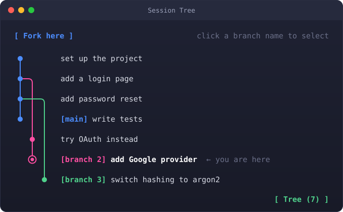

# 🌳 Session Tree for Claude Code

A git-style graph of every turn in a Claude Code session, shown in a pane beside the chat.
Click any earlier turn to jump the conversation back to it. Your next prompt then starts a new
branch, and the other branches stay in the tree so you can switch back to them later.

<p align="center">
  
</p>

## Features

- **Graph pane**: every turn as a dot, labelled with its prompt and a preview of the reply.
  Branches get tags such as `[main]` and `[branch 2]`. The first turn is at the top.
- **Jump**: click a turn, or use `/tree-go N`, and Claude sees only the conversation up to that
  turn on that branch.
- **Branch**: after a jump, the next prompt opens a new branch from that turn.
- **Fork here**: at the tip of a branch, start a new branch from it without jumping.
- **Delete branch**: click a branch's tag to select it, then 🗑 Delete → Yes. The branch and every
  branch grown from it are removed. If you are standing on it, the tree first jumps back to the
  fork point so Claude forgets it too. `main` cannot be deleted.
- **Undo delete**: restores the last deleted branch.
- **Queued prompts**: a prompt typed while a turn runs still gets its own dot.

## How it works

### The tree is stored outside the conversation

Each turn is a node with a pointer to its parent turn:

```ts
type TurnNode = {
  id: string
  parent: string | null   // the turn this one continued from
  n: number               // turn number (never reused, even after a delete)
  prompt: string          // the prompt as typed
  reply: string           // short preview of the answer
  built: string           // the whole turn flattened to text, used to rebuild a branch
  at: number
  fork?: boolean          // made after "Fork here"
}
```

The tree also keeps a `head`: the turn you are currently on. A new turn gets `parent = head` and
becomes the new head. Branches are not stored anywhere; they are worked out from the parent
links when the graph is drawn. The oldest child of a turn continues its branch, and every other
child starts a new one.

This bookkeeping costs **zero tokens** in the model's context: Claude never sees markers or
branch labels, only the conversation along the current path.

### A jump rewrites the context

A jump is done with Claude Code's own compaction hook, but instead of summarizing, it cuts:

1. `session-tree` calls `$.session.compact` with a special instruction that carries the target
   turn and the branch's nodes.
2. `session-tree-cut` catches that compaction, keeps the original messages up to the part shared
   with the target branch, and appends the rest of the target branch rebuilt from the stored turns.
3. The result replaces the conversation. No summary is written and no `/compact` rows appear.

The cut lives in a **separate mod** because Claude Code does not run a mod's own
`session.compact` hook for a compaction that the same mod started.

## Installation

1. In Claude Code, type the first line at the prompt:

   ```
   /plugin install session-tree --marketplace RodrigoCossi/claude-code-session-tree
   ```

   The first time, it asks whether to add the marketplace: answer `y`.
   When it asks for a scope, choose **user** (the first option, then Enter). The mod then loads
   in every Claude Code session, in any folder.

2. Type the second line the same way:

   ```
   /plugin install session-tree-cut --marketplace RodrigoCossi/claude-code-session-tree
   ```

   **Both lines are required.** `session-tree` draws the tree; `session-tree-cut` is what switches
   the conversation when you jump. Without it, a jump runs a normal summarizing compaction
   (see [How it works](#how-it-works)).

3. Check that it loaded: a **🌳 Tree** button appears at the bottom right of the prompt. Click it,
   or type `/tree`.

**Private repository:** installing works only for GitHub accounts that can read this repository,
on a machine where git can already authenticate to github.com (for example after
`gh auth login` and `gh auth setup-git`). The install does not ask for a password.

**Load it only once:** if you also load these folders another way (for example through
`CLAUDE_CODE_PLUGIN_DIRS` while developing), two Tree panes appear and closing one seems not
to work.

## Usage

| Action | How |
| --- | --- |
| Open / close the tree | 🌳 Tree button in the prompt footer, or `/tree` |
| Jump to a turn | Click it in the pane, or `/tree-go N` |
| New branch from an earlier turn | Jump to it, then type your next prompt |
| New branch from the tip you're on | **Fork here**, then type |
| Delete a branch | Click its `[tag]`, then 🗑 Delete → Yes |
| Undo the last delete | **↶ Undo delete** |

The pane asks for the widest dock Claude Code allows (45% of the terminal).

## Known issues and things to watch

These come from reading the code. None of them has been measured yet.

### Token and context cost

- **What costs nothing**: the tree itself never enters the model's context, and a jump does not
  ask the model to summarize anything. After a jump, the context holds only the path to the target
  turn, so it never grows from keeping several branches.
- **Every jump breaks the prompt cache.** Claude Code resends the whole conversation on every
  prompt, and the unchanged start of it is normally served from Anthropic's prompt cache at a
  fraction of the price. A jump changes everything after the fork point, so the next prompt pays
  full price for that part. Caching works again from the prompt after. Switching branches often
  costs more than staying on one.
- **Tool results come back shortened.** When a branch is rebuilt, each tool call's input is cut to
  600 characters and each result to 1,500. That makes the rebuilt branch smaller than the original,
  but if Claude needs a file it read on that branch, it has to read it again, and those extra reads
  can cost more than was saved.

### Correctness

- **Long turns can lose their final answer.** Each turn is stored as text of at most 30,000
  characters, and the cut keeps the *start*. In a long turn with many tool calls (roughly 15–20 or
  more), the part dropped is the end: the final answer. After jumping back to that branch, Claude
  would see the work but not the conclusion. Possible fix: always keep the final reply and cut from
  the middle.
- **Turns are found by their prompt text.** To decide where to cut, the companion mod matches each
  turn's prompt against the conversation. Two identical prompts (for example, "continue") can make
  it cut in the wrong place and build the wrong context.

### Scope

- **Only the conversation changes.** Files written and commands run on a deleted or abandoned
  branch stay done. If Claude reads those files on another branch, it sees their result. The raw
  session transcript also keeps everything.
- **One tree per session.** Turns from before the mod was loaded, or from a session Claude Code
  moved to a new session id, are not in the tree.
- Up to the last 500 turns are kept.

## Tests

```sh
claude plugin test session-tree
claude plugin test session-tree-cut
```

The `.claude-plugin/types/` folders are generated by Claude Code and are not committed.

## Repository layout

```
session-tree/          graph pane, Tree button, /tree and /tree-go, records each turn
  hooks/register.tsx
  types/index.d.ts     TurnNode and Tree types
session-tree-cut/      applies a jump to the conversation
  hooks/cut.tsx
```
